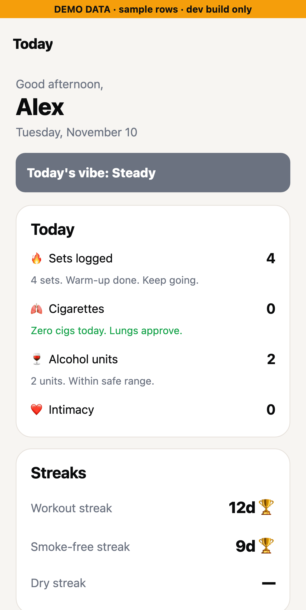
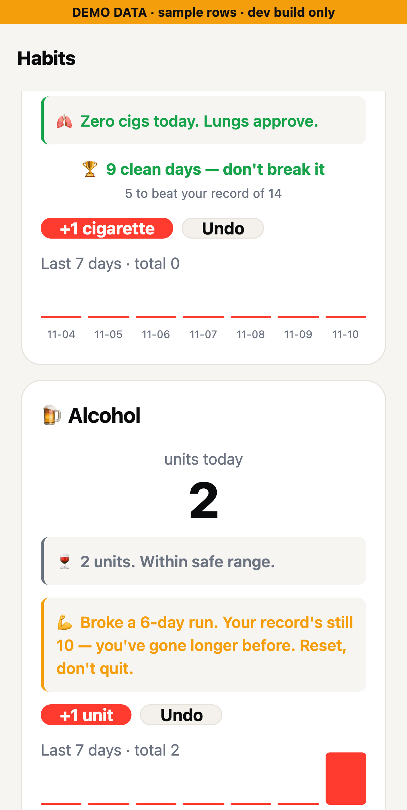
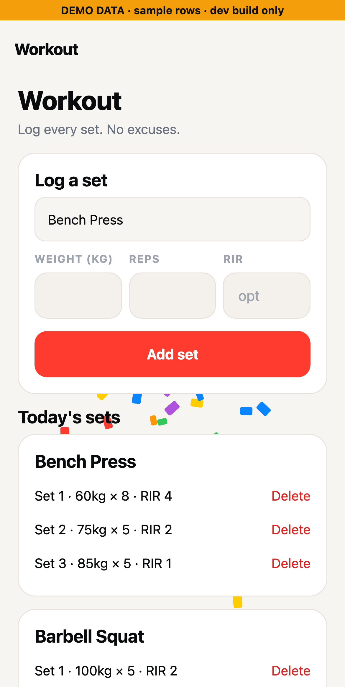
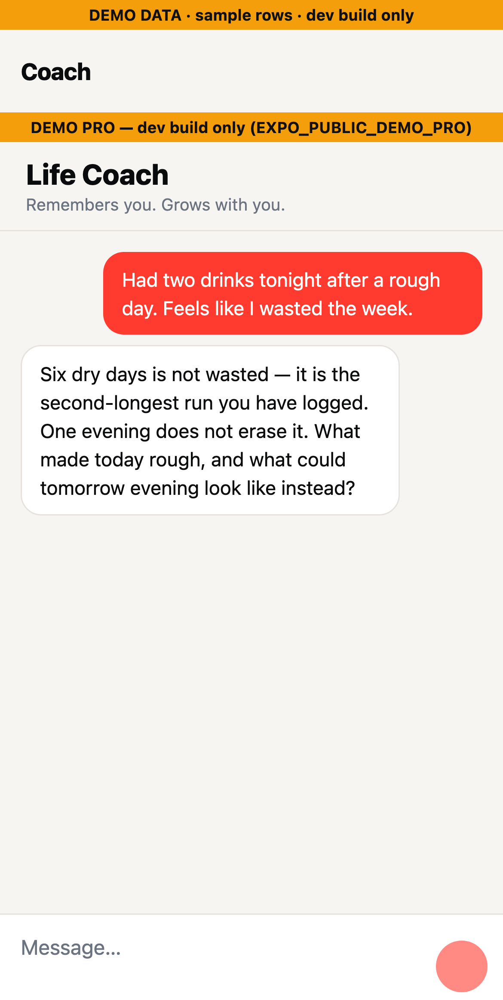

<div align="center">

# ComeBack

**Rebuild your streak. Own your body. Reset your mind.**

A privacy-first habit and workout tracker with an AI coach — built with Expo, React Native, and Supabase.

[](https://github.com/prathamshukla28/-ComeBack-/actions/workflows/ci.yml)
[](https://github.com/prathamshukla28/-ComeBack-/actions/workflows/codeql.yml)
[](https://github.com/prathamshukla28/-ComeBack-/actions/workflows/release-please.yml)
[](./LICENSE)
[](https://docs.expo.dev/versions/v54.0.0/)
[](https://reactnative.dev/)
[](https://www.typescriptlang.org/)
[](https://supabase.com/)
[](https://www.conventionalcommits.org/)

<sub>Made with care · Runs on iOS, Android, and Web via Expo</sub>

</div>

---

## ✨ Features

- 📊 **Daily dashboard** — one-glance view of today's sets, streaks, and habits
- 🏋️ **Workout tracker** — log sets, reps, weights; visualize progression
- 🧘 **Habit journal** — track cigarettes, alcohol, intimacy with clean-streak counters
- 🔁 **Relapse-aware streaks** — a lapse never cold-resets you to zero; it reframes the broken run against your personal best and nudges you to rebuild
- 📈 **Trends** — week-over-week deltas and sparklines for habits and workouts, colour-coded toward your goal
- 📡 **Offline-safe logging** — a tap on a flaky connection is persisted to a durable outbox and replayed on reconnect; logs are never lost
- 🛟 **Coach safety net** — self-harm signals short-circuit the LLM and surface vetted crisis resources (988 / Samaritans / findahelpline) instead
- 🧠 **Two AI chats** — a **Fitness Guru** (optionally RAG-grounded in a curated exercise KB + your own history via pgvector) and a Pro **Life Coach** with long-term memory, both on Google Gemini
- 🧷 **Injection-resistant coach memory** — facts the model extracts are schema-validated, instruction-shaped content is dropped, and memories re-enter prompts only as quoted, delimited data
- 💳 **ComeBack Pro** — RevenueCat paywall on the client, **enforced server-side** for anything that spends the operator's API key (RLS-protected entitlements fed by a RevenueCat webhook)
- 🔒 **Biometric lock** — Face ID / Touch ID gate for sensitive tabs, with a salted-hashed, rate-limited PIN fallback (the tab stays locked on web, which has no keychain)
- 🔔 **Local notifications** — gentle nudges when your streaks are on the line
- 🎨 **Adaptive theming** — polished light and dark palettes
- 🎉 **Delightful micro-interactions** — haptics, animated numbers, confetti wins
- ☁️ **Sync everywhere** — Supabase Postgres with row-level security

## 📱 Screenshots

> **Demo data.** These are real renders of the app's own screens (Expo **web** build, 390×844 @3x, headless Chromium), running on the dev-only demo-data mode: an in-memory, clearly badged set of sample rows, with no Supabase project and no Gemini calls. The two chat transcripts are seeded sample text, **not** live model replies. Two web-only quirks: SF Symbols icons don't render on web, and the bottom tab bar is cropped out. Reproduce with `EXPO_PUBLIC_DEMO_DATA=1 EXPO_PUBLIC_DEMO_PRO=1 npx expo start --web`.

|                                 Today                                  |                                            Habits                                            |                                     Workout                                     |
| :--------------------------------------------------------------------: | :------------------------------------------------------------------------------------------: | :-----------------------------------------------------------------------------: |
|  |    |  |
|       Daily dashboard: today's counts and streaks _(demo data)_        | A 9-day clean run vs. a record of 14, and a relapse reframed against your best _(demo data)_ |  85 kg × 5 beats the stored bench e1RM, so the PR confetti fires _(demo data)_  |

|                           Fitness Guru                           |                                Life Coach (Pro)                                |                                     PIN lock                                      |
| :--------------------------------------------------------------: | :----------------------------------------------------------------------------: | :-------------------------------------------------------------------------------: |
|  |  |                  |
| Guru chat with a seeded demo transcript, not a live Gemini reply |      Coach unlocked by the dev-only **DEMO PRO** flag, seeded transcript       | Private tab locked: Face ID with a hashed, rate-limited PIN fallback _(demo PIN)_ |

## ▶️ Run the demo

1. Follow **Quick Start** below (Supabase project + `db/schema.sql`, `.env`).
2. Sign in, open **Settings**, and paste your own [Gemini API key](https://aistudio.google.com/app/apikey) (stored in the OS keychain, never in the bundle).
3. Log a few sets and habit taps — the Today, Habits and Trends screens fill in, and logging keeps working offline.
4. **Life Coach (Pro)** — in a dev build, unlock it without a purchase:

   ```bash
   EXPO_PUBLIC_DEMO_PRO=1 npx expo start
   ```

   The Coach tab shows an amber **DEMO PRO** banner. This flag only affects development builds: it requires `__DEV__`, refuses when `NODE_ENV` is `production`, and never grants server-side Pro (see [`lib/demo.ts`](./lib/demo.ts), [`docs/MONETIZATION.md`](./docs/MONETIZATION.md#demo-mode-dev-builds-only)).

5. **No backend at all?** Start a dev build on sample data instead:

   ```bash
   EXPO_PUBLIC_DEMO_DATA=1 npx expo start
   ```

   The app signs in a local demo user and the real screens and data layer run on an in-memory set of sample rows ([`lib/demo-data.ts`](./lib/demo-data.ts)); every screen carries an amber **DEMO DATA** badge, and the private tab's demo PIN is `1234`. Same dev-only guards as demo Pro; nothing is sent to Supabase.

6. **RAG-grounded Guru (optional)** — run the service in [`rag/`](./rag/README.md), set `EXPO_PUBLIC_RAG_URL`, and grant your test user Pro from the SQL editor (snippet in [`db/entitlements.sql`](./db/entitlements.sql)).

## 🧱 Tech Stack

| Layer         | Choice                                                                                           |
| ------------- | ------------------------------------------------------------------------------------------------ |
| **Runtime**   | Expo SDK 54, React Native 0.81, React 19                                                         |
| **Language**  | TypeScript 5.9 (strict)                                                                          |
| **Routing**   | [expo-router](https://docs.expo.dev/router/introduction/) (file-based)                           |
| **State**     | [TanStack Query](https://tanstack.com/query) (server state) + React context (auth, subscription) |
| **Data**      | [Supabase](https://supabase.com/) (Postgres, Auth, RLS)                                          |
| **AI**        | Google Gemini (`lib/gemini.ts`); optional FastAPI + pgvector RAG service in `rag/`               |
| **Billing**   | RevenueCat (client) + webhook-fed, RLS-protected entitlements (server)                           |
| **Animation** | `react-native-reanimated` v4 + Worklets                                                          |
| **Storage**   | `expo-secure-store`, `@react-native-async-storage/async-storage`                                 |
| **Quality**   | ESLint, Prettier, Husky, lint-staged, commitlint, Jest, GitHub Actions, CodeQL, Dependabot       |

## 🚀 Quick Start

**Prerequisites:** [Node.js 22+](https://nodejs.org), a free [Supabase](https://supabase.com) project, the [Expo Go](https://expo.dev/client) app on your phone.

```bash
# 1. Clone
git clone https://github.com/prathamshukla28/-ComeBack-.git comeback
cd comeback

# 2. Install
npm install

# 3. Configure
cp .env.example .env
# then edit .env with your Supabase URL + anon key

# 4. Run
npm start          # then scan the QR code with Expo Go
npm run ios        # or open on iOS simulator
npm run android    # or Android emulator
npm run web        # or in the browser
```

Full walk-through with Supabase provisioning and schema import lives in [`docs/SETUP.md`](./docs/SETUP.md).

## 📁 Project Structure

```text
.
├── app/                    # expo-router file-based routes
│   ├── (tabs)/             # Bottom-tab navigator
│   │   ├── index.tsx       # Today dashboard
│   │   ├── workout.tsx     # Workout logger (PR detection)
│   │   ├── habits.tsx      # Habit journal + relapse-aware streaks
│   │   ├── trends.tsx      # Week-over-week trends
│   │   ├── intimacy.tsx    # Private tab (biometric-gated)
│   │   ├── guru.tsx        # Fitness Guru chat (RAG-grounded for Pro when the service is set)
│   │   ├── coach.tsx       # Life Coach chat (Pro)
│   │   └── settings.tsx    # Profile, Gemini key, PIN, subscription
│   ├── _layout.tsx         # Root providers, theme, outbox replay
│   ├── paywall.tsx         # Modal paywall route
│   └── login.tsx           # Supabase auth screen
├── components/             # UI primitives (ui.tsx), Chat, Paywall, Confetti, ...
├── lib/                    # Non-UI logic (unit-tested)
│   ├── queries.ts          # Typed Supabase data access (local-day convention)
│   ├── streaks.ts          # Pure streak + local-day math
│   ├── coach-memory.ts     # Memory validation + quoting (prompt-injection defence)
│   ├── coach-prompt.ts     # Life Coach prompt assembly + memory extraction
│   ├── outbox.ts           # Durable offline queue for habit taps
│   ├── safety.ts           # Crisis detection + safety preamble
│   ├── purchases.ts        # RevenueCat wrapper
│   ├── subscription.tsx    # Pro state context (+ dev-only demo mode, demo.ts)
│   ├── demo.ts / demo-data.ts  # dev-only demo Pro + in-memory sample data (inert in prod)
│   ├── rag.ts / gemini.ts  # AI clients
│   ├── pin.ts, sessionStorage.ts, secureStore.ts  # on-device secrets
│   └── env.ts              # zod-validated env
├── db/                     # schema.sql, rag.sql (pgvector), entitlements.sql (+ RLS integration test)
├── rag/                    # Python FastAPI RAG service (auth → rate limit → Pro → Gemini)
├── test-utils/             # Supabase query-builder mock, time-zone-pinning Jest env
├── docs/                   # SETUP, RAG, MONETIZATION
└── .github/                # CI, CodeQL, Dependabot, release-please, EAS preview
```

## 🛠️ Scripts

| Script                  | Purpose                                                                  |
| ----------------------- | ------------------------------------------------------------------------ |
| `npm start`             | Start Metro / Expo dev server                                            |
| `npm run ios`           | Launch on iOS Simulator                                                  |
| `npm run android`       | Launch on Android emulator                                               |
| `npm run web`           | Launch web build                                                         |
| `npm run typecheck`     | `tsc --noEmit`                                                           |
| `npm run lint`          | ESLint over the source tree                                              |
| `npm run lint:fix`      | ESLint with `--fix`                                                      |
| `npm run format`        | Prettier write across the repo                                           |
| `npm run format:check`  | Prettier verify (CI-friendly)                                            |
| `npm test`              | Run Jest test suite                                                      |
| `npm run test:watch`    | Jest in watch mode                                                       |
| `npm run test:coverage` | Jest with coverage report                                                |
| `npm run test:rls`      | RLS integration test (needs a local Supabase stack; see `docs/SETUP.md`) |

## 🧪 Quality Gates

Every push and PR runs through:

- ✅ **TypeScript strict** — `tsc --noEmit` must be error-free
- ✅ **ESLint** (`eslint-config-expo` + Prettier compatibility) — `--max-warnings=0`
- ✅ **Prettier** formatting check
- ✅ **Jest** — **296 tests** across `lib/` logic (`queries`, `streaks`, `coach-memory`, `coach-prompt`, `safety`, `outbox`, `pin`, `purchases`, `subscription`, `demo`, `demo-data`, `notify`, `secureStore`, `rag`, `gemini`, `env`, `insights`, `sessionStorage`), `components/` UI, and the RLS/entitlement policy shape in `db/*.sql`. Day-bucketing and streak edge cases near midnight run with the worker's real time zone pinned to **Asia/Kolkata** and **America/Los_Angeles** (`test-utils/timezone-env.js`). Coverage is ratcheted per layer (`lib/` ≥ 75%) and uploaded to Codecov
- ✅ **RLS integration test** (opt-in, `npm run test:rls`) — two real users against a local Supabase stack: no cross-user reads/writes, no self-granted Pro, duplicate set numbers rejected. Skipped automatically when no stack is configured
- ✅ **pytest** — the `rag/` service (56 tests, all network mocked): token verification before any Gemini spend, per-user rate limiting, server-side Pro enforcement, the RevenueCat webhook, and the user-JWT isolation contract
- ✅ **markdownlint-cli2** — docs quality
- ✅ **CodeQL** security scanning (JavaScript/TypeScript **and** Python, `security-and-quality` query set)
- ✅ **Dependabot** — grouped weekly updates for npm, pip (`rag/`), and GitHub Actions; actions are pinned to commit SHAs
- ✅ **release-please** — automated CHANGELOG + version bumps from Conventional Commits
- ✅ **EAS Preview** (opt-in) — automated iOS/Android builds on PRs when `EXPO_TOKEN` is configured

Locally, Husky wires the same guardrails into:

- **pre-commit** — `lint-staged` runs ESLint + Prettier on staged files
- **commit-msg** — `commitlint` enforces Conventional Commits
- **pre-push** — full typecheck + test suite before anything leaves your machine

## 🤝 Contributing

Contributions are welcome. Please read [`CONTRIBUTING.md`](./CONTRIBUTING.md) and follow the [Code of Conduct](./CODE_OF_CONDUCT.md). All commit messages follow [Conventional Commits](https://www.conventionalcommits.org/).

## 🔐 Security model

- **Isolation is a database invariant.** Every user table has owner-only RLS; the RAG service forwards the user's JWT instead of using a service key, so Postgres decides what each request can see ([`docs/RAG.md`](./docs/RAG.md)).
- **Paid resources are checked on the server.** The paywall decides what the app shows; anything that spends the operator's Gemini key re-checks the `pro` entitlement server-side. Users can read but never write their entitlement row ([`docs/MONETIZATION.md`](./docs/MONETIZATION.md#where-pro-is-enforced)).
- **Model output is untrusted input.** Coach memories are validated before storage and fed back only as quoted, delimited data ([`lib/coach-memory.ts`](./lib/coach-memory.ts)); self-harm signals bypass the model entirely ([`lib/safety.ts`](./lib/safety.ts)).
- **No secrets in the bundle.** Each user's Gemini key and PIN hash live in the OS keychain; the Supabase session is encrypted at rest.

Found a vulnerability? Please **do not** open a public issue. Review [`SECURITY.md`](./SECURITY.md) for private disclosure instructions.

## 📜 License

[MIT](./LICENSE) © Pratham Shukla
